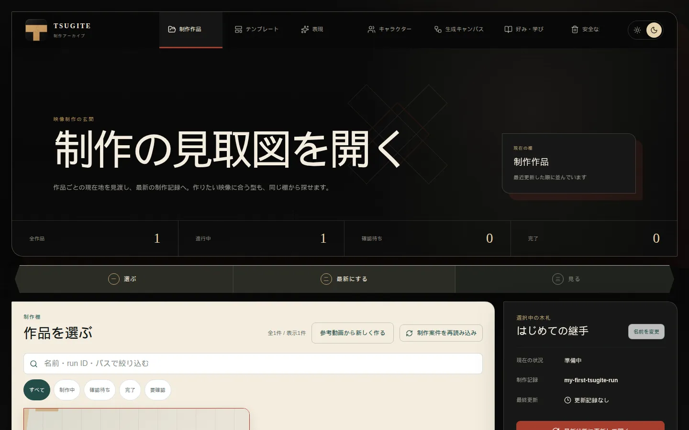

# Tsugite（継手）

[日本語](README.ja.md) | [English](README.md) | [中文](README.zh.md) | [한국어](README.ko.md)

新しく始める動画は **v2**（いまの版は `2.0.0-alpha.5`。正式版 2.0.0 ではない）で作ります。計画を人が確認してから生成し、直した好みは次の1本へ残します。既存の `project.yaml` 案件は **v1**（`0.18.0`）の保守として続けます。

以前のコマンド一覧は [技術リファレンス](docs/reference.ja.md) にあります。

## こんな人に

- 同じ指示を、毎回いちから出し直したくない。
- 生成サービスの課金は、内容を確認してからにしたい。
- 前に直したところを、次の1本でも残したい。

Codex か Claude Code に、自分の言葉で頼めます。

## はじめ方

コマンドを自分で打たなくても始められます。

1. このリポジトリを手元に置く。
2. 下の依頼文をエージェントに貼る。
3. 報告された確認ページの URL を自分で開き、承認は自分で押す。

```text
このリポジトリの Tsugite v2（2.0.0-alpha.5）で、課金しない6秒サンプルを準備してください。
公式リポジトリ：
https://github.com/Takamasa045/tsugite
AGENTS.md と v2/skills/tsugite/SKILL.md を読み、
npm --prefix v2 ci --ignore-scripts のあと、
npm run --silent v2 -- init、check、plan まで進めてください。
確認ページの URL を教えてください。承認ボタンは私が押します。
承認を確認できたときだけ make と export に進めてください。
APIキーの設定、課金、既存の project.yaml の変更、commit、push はしないでください。
```

必要なソフトは Node.js 22.12以上の22.x、npm 10以上、FFmpeg（`ffprobe` と `libx264`）です。手順の詳細は [6秒で環境確認](docs/onboarding/first-video.ja.md) です。

## クイックスタート

リポジトリのルートで実行します。見本は課金も外部サービスも使いません。`plan` は確認ページの URL を出し、そのプロセスは開いたままにします。ブラウザは `--open` を付けたときだけ開きます。v2 は `TSUGITE_PROJECTS_HOME` を読みません。見本フォルダ `./my-video` は新しく作り、既存の `projects/` には書きません。

macOS / Linux:

```sh
npm --prefix v2 ci --ignore-scripts
npm run --silent v2 -- init ./my-video
npm run --silent v2 -- check --project ./my-video
npm run --silent v2 -- plan --project ./my-video
```

Windows の PowerShell でも、同じ4行です。

```powershell
npm --prefix v2 ci --ignore-scripts
npm run --silent v2 -- init ./my-video
npm run --silent v2 -- check --project ./my-video
npm run --silent v2 -- plan --project ./my-video
```

計画を承認したあと、別のターミナルで書き出します。PowerShell でも同じです。

```sh
npm run --silent v2 -- make --project ./my-video
npm run --silent v2 -- export --project ./my-video
```

完成ファイルは `my-video/out/final.mp4` です。見本は新しい素材を作らないため、クリップ確認を自動で通します。生成をする案件は、確認ページでクリップを承認してから `export` します。`npx tsugite` ではこの alpha を取れません。

## 物語の相談から始める

素材や生成の前に、構成だけ先に決められます。相談は画像も確認ページも要らず、生成・外部送信・課金・承認をしません。採用した構成を案件へ結んでから、上の `plan` で確認ページを開きます。構成を変えると古い承認では先へ進めません。変わった箇所は再確認の対象になります。素材は自動では作り直しません。

同じコマンドが、このリポジトリでも npm の配布物から入れた v2 でも動きます。相談が読むのはパッケージ内の `knowledge/story-frameworks/catalog.yaml` だけです。出典は同じ場所の `NOTICE.md` です。親ディレクトリは探しません。カタログはデータであり、その型を生成できるという意味ではありません。

```sh
npm run --silent v2 -- plugin story consult --request "60秒の静かな自然映像。ドラマ・CTA不要" --seconds 60
```

PowerShell でも同じ1行です。採用した JSON は `plugin story check` のあと `plugin story bind` で結び、続けて `plan` します。詳細は [物語・構成の相談](v2/docs/story-consult.ja.md) です。相談の実装は [#245](https://github.com/Takamasa045/tsugite/pull/245)、カタログの同梱は [#246](https://github.com/Takamasa045/tsugite/pull/246) です。

## v1 の案件を v2 へ写す

元の `project.yaml` 案件は残ります。承認も秘密情報も写しません。対応するローカルのカット、音、普通の字幕だけを新しいフォルダへコピーします。

```sh
npm run --silent v2 -- init ./my-video --from-v1 /path/to/v1-project
```

PowerShell でも同じ1行です。パスは自分の案件に置き換えてください。案件専用の Remotion 構成やキャラクターの編集グラフは移せません。完成動画だけ写すときは `--flatten out/final.mp4`、元データの保管を足すときは `--archive-v1` を、同じ `init` に付けます。どちらも `--from-v1` が必要です。写したあとは、新しい計画を確認ページで承認します。

## 生成サービスへのつなぎ方

PixVerse、Kling、TopView は、API キーを設定に書く方式ではつなぎません。各サービスの CLI で、そのサブスクリプションにログインした状態で使います。v2 は確認ページの承認後にその CLI を呼びます。実機確認は未了です。ログイン先や課金先は、この手順では選びません。上のクイックスタートは、これらの CLI を呼びません。

ElevenLabs の効果音（SFX）は、実課金の受け入れが1件記録されています。音声と music の実課金受け入れはまだです。PixVerse の実生成と、その生成から最終ファイルまでの通し書き出しは、サブスク CLI での実機確認として未了です。

## v1 は保守として残る



既存の `project.yaml` 案件は v1 `0.18.0` のまま完走します。入口のコマンドは `node bin/pipeline` で、一覧は [技術リファレンス](docs/reference.ja.md#コマンド) です。Windows の注意は [Windowsネイティブ利用ガイド](docs/windows.md) です。初回セットアップの依頼文は [こちら](docs/onboarding/codex-setup-prompt.ja.md) です。

v1 では、人が3回止めるまで進みません。唯一の例外は、案件が `gates.gate_2.auto_pass: qc_ok_no_new_assets` を選んだときです。課金・新しい素材・品質の指摘がすべて0のときだけ、素材の確認（Gate 2）は人の OK なしで通ります。

v2 の確認は確認ページだけです。CLI に承認フラグはありません。

## もっと詳しく

- 版：v2 は `2.0.0-alpha.5`。正式版 2.0.0 の条件は [移行判断](v2/docs/migration-plan.ja.md) と [要件](v2/docs/requirements.md) です。
- v2 のコマンド詳細：[v2/README.ja.md](v2/README.ja.md) · [v2/README.md](v2/README.md)
- 用途から選ぶ：[see-and-choose](docs/onboarding/see-and-choose.ja.md)
- 変更履歴：[CHANGELOG.md](CHANGELOG.md) · [v2/CHANGELOG.md](v2/CHANGELOG.md)
- 開発：[CONTRIBUTING.md](CONTRIBUTING.md)
